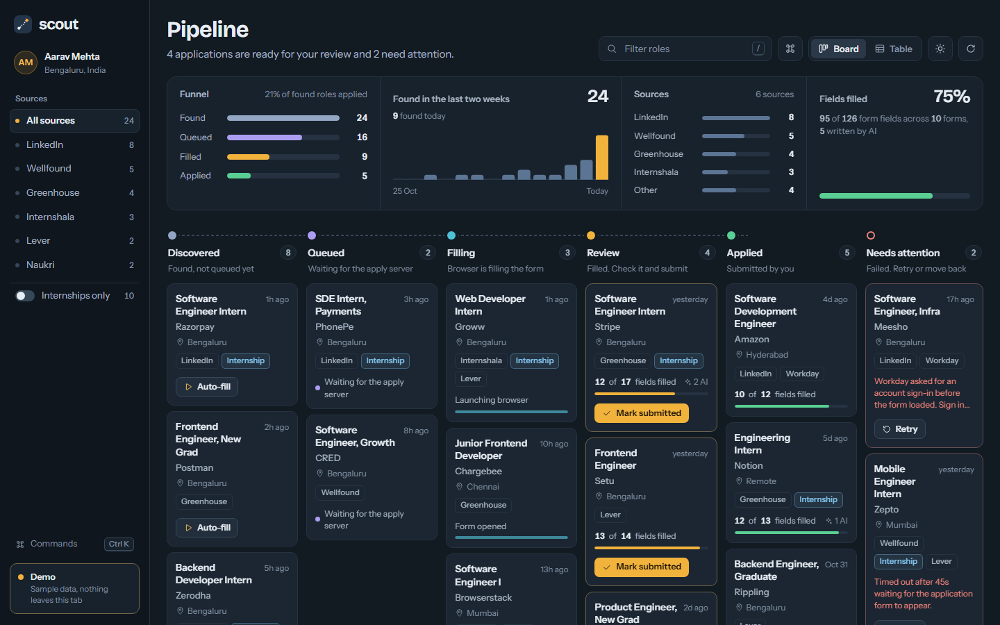

# Scout

Scout is a personal job-application copilot. It finds new developer jobs, lets you queue the ones you like from a dashboard, and then drives a real browser to fill in the application form for you — **and stops before submitting, so you review everything and press Submit yourself.**



```
 n8n (Docker)            Supabase                 Dashboard (Next.js)
 every 6 hours           listings / applications  browse jobs, click Apply
 Himalayas, Arbeitnow,   ───────────────────────► status = pending_application
 RemoteOK  ────────────► listings                         │
                                                          ▼
              Apply server (Node, on your machine) ◄── Realtime + 30s fallback poll
              detect ATS → read form fields → match to your profile
              (rules → semantic → LLM) → safety filter → fill with Playwright
                                   │
                                   ▼
                     visible browser: you review and submit
```

## What it does

- **Discovery** — an n8n workflow pulls remote developer jobs from Himalayas, Arbeitnow and RemoteOK, de-duplicates them (tracking parameters and trailing slashes are ignored), and stores them in Supabase.
- **Dashboard** — a Next.js app with a pipeline board (Discovered → Queued → Filling → Review → Applied), live stats, a details drawer with the full fill report, and a *Teach Scout* control for fields it skipped. Dark and light themes, a command menu (`Ctrl K`), and a demo mode (`http://localhost:3000/?demo=1`) that runs on sample data with no backend. See [`dashboard/README.md`](dashboard/README.md).
- **Autofill** — a Playwright bot detects the ATS (Greenhouse, Lever, Ashby, Workday, iCIMS, SmartRecruiters; anything else uses a generic adapter), reads the form, and fills what it can. Free-text questions get a short answer written by an LLM from your profile only; weak answers are left blank.
- **Safety** — Scout leaves these alone and never sends them to the model: demographic/EEOC fields, legal-status questions (work authorization, visa sponsorship, citizenship, criminal record, background checks, security clearance), questions about other people (emergency contacts, references), passwords, CAPTCHAs and tracking fields. It judges a field by its label, the heading of its section and its answer options, and it never ticks a checkbox. This is pattern-based, so it cannot be perfect: you always review the form. Low-confidence fields are skipped and listed in the fill report. Scout never clicks Submit; on multi-step forms it only clicks a plain *Continue/Next* button, and never on a Review or Submit step.

## Prerequisites

- Node.js 22 or newer (Supabase Realtime needs the native WebSocket; developed on Node 24)
- A free [Supabase](https://supabase.com) project
- Docker (for n8n)
- An LLM — any one of: Azure OpenAI, OpenAI, Gemini, Groq, or a local Ollama model (see [LLM providers](#llm-providers))

## Setup

1. **Create the database.** In your Supabase project open *SQL Editor*, paste the contents of [`n8n/supabase-schema.sql`](n8n/supabase-schema.sql) and run it. It is safe to run again.
2. **Configure the server.** Copy `.env.example` to `.env` and fill it in. You need the project URL, the anon key, the **service-role key** (Supabase → Project settings → API), an LLM provider, and an `N8N_ENCRYPTION_KEY` (`openssl rand -hex 24`).
3. **Add your profile.** Copy `profile.example.json` to `profile.json` and fill in your details and the absolute path to your resume PDF. This file is git-ignored.
4. **Install and start the apply server** (on your own machine, not in Docker — it opens a visible browser for review):
   ```bash
   npm install
   npm start
   ```
   It listens on `http://localhost:3001`.
5. **Start the dashboard.** Create `dashboard/.env.local`:
   ```
   NEXT_PUBLIC_SUPABASE_URL=https://your-project.supabase.co
   NEXT_PUBLIC_SUPABASE_ANON_KEY=your_anon_key
   NEXT_PUBLIC_LOCAL_API=http://localhost:3001
   ```
   then:
   ```bash
   cd dashboard
   npm install
   npm run dev
   ```
   and open `http://localhost:3000`. The sidebar shows whether the apply server is reachable.
6. **Start n8n.** From the repository root:
   ```bash
   docker compose up -d
   ```
   Open `http://localhost:5678`, create the owner account, open the **Scout Job Discovery** workflow (already imported), run it once with *Test workflow*, then **Publish** it (older n8n versions call this *Active*) so it runs every 6 hours. Listings appear in the dashboard.
7. **Apply.** Click *Auto-fill* on a job. The apply server picks it up, opens the form, fills it, and leaves the browser open for you.

## Supported platforms

| Platform | How it is handled | Verified |
|---|---|---|
| Greenhouse, Lever, Ashby | dedicated adapters with the platform's own field ids | fixture forms in real Chromium |
| Workday | multi-step wizard: waits for each step to settle, fills it, advances with *Save and Continue*, and stops at the Review step; stops at a sign-in wall | fixture wizard |
| iCIMS | fills the application inside its iframe (not other frames); stops at a login step | fixture page |
| SmartRecruiters | reads forms built from web components (open shadow DOM) | fixture page |
| Anything else | generic adapter (labels, names, types) | fixture form |

The adapters are written from each platform's public markup conventions and exercised against fixture pages that mimic them. **They have not been verified against live company sites**, so expect to review every filled form (you always do — Scout never submits). Scout never handles credentials, and each run starts a fresh browser, so it **cannot resume after you sign in**: on a Workday or iCIMS tenant that requires an account, Scout stops at the sign-in page and tells you so; sign in and complete the application yourself in the browser it leaves open. A run that finds no form fields at all (for example the job posting instead of the application form) is also reported as needing you, not as filled.

## Environment variables

| Variable | Used by | Purpose |
|---|---|---|
| `NEXT_PUBLIC_SUPABASE_URL` | server, dashboard, n8n | Supabase project URL |
| `NEXT_PUBLIC_SUPABASE_ANON_KEY` | dashboard | Browser key: read access, can queue/reset/mark applications |
| `SUPABASE_SERVICE_ROLE_KEY` | server, n8n | **Secret.** Server-side key; never put it in the dashboard |
| `N8N_ENCRYPTION_KEY` | docker compose | Encrypts n8n's stored credentials; generate once and keep it |
| `GENERIC_TIMEZONE` | docker compose | n8n schedule timezone (default `UTC`) |
| `LLM_PROVIDER` | server | `azure` or `openai`; auto-detected when unset |
| `AZURE_OPENAI_ENDPOINT`, `AZURE_OPENAI_KEY`, `AZURE_OPENAI_DEPLOYMENT` | server | Azure OpenAI provider |
| `LLM_API_KEY`, `LLM_BASE_URL`, `LLM_MODEL` | server | OpenAI-compatible provider |
| `PORT` | server | Apply server port (default `3001`) |
| `HOST` | server | Address to bind (default `127.0.0.1`, loopback only; the Docker image sets `0.0.0.0`) |
| `DASHBOARD_ORIGIN` | server | Browser origin(s) allowed to call the server, comma-separated (default `http://localhost:3000`, `http://127.0.0.1:3000`) |
| `HEADLESS` | server | `false` shows the browser (needed for review); defaults to headless on Linux/cloud |
| `LOG_LEVEL` | server | `debug`, `info`, `warn`, `error` |
| `PROFILE_JSON` | server | Profile as one-line JSON, used if `profile.json` is missing |
| `NEXT_PUBLIC_LOCAL_API` | dashboard | Apply server URL (default `http://localhost:3001`) |

## LLM providers

Set `LLM_PROVIDER`, or leave it unset and Scout picks Azure when all three `AZURE_OPENAI_*` variables are present, otherwise the OpenAI-compatible provider when `LLM_API_KEY` or `LLM_BASE_URL` is set.

| Provider | `LLM_BASE_URL` | `LLM_MODEL` (example) | Key |
|---|---|---|---|
| OpenAI | `https://api.openai.com/v1` | `gpt-4o-mini` | required |
| Gemini | `https://generativelanguage.googleapis.com/v1beta/openai` | `gemini-2.0-flash` | required |
| Groq | `https://api.groq.com/openai/v1` | `llama-3.3-70b-versatile` | required |
| Ollama (local) | `http://localhost:11434/v1` | `llama3.1` | not needed |

With no provider configured Scout still works: fields are matched by rules only and free-text questions are left for you.

## Application status

`Discovered` → `pending_application` (you clicked Apply) → `applying` → `application_opened` → `form_analyzed` → `autofill_completed` / `awaiting_review` → `submitted` (you submitted). `failed` carries the error message and can be retried from the dashboard.

## Security notes

- The dashboard's anon key can read everything and can only queue, reset or mark-submitted an application, and only through the three status columns. It cannot write listings or forge pipeline states. The rules are in the schema file.
- `fill_report` is readable with the anon key because the dashboard shows it. Keep your Supabase URL private; it is a personal project, not a multi-user product.
- The apply server listens on loopback only and accepts browser calls only from the dashboard origin, so other websites and other machines cannot make it fill forms with your details. n8n is likewise published on `127.0.0.1` only.
- `.env` and `profile.json` are git-ignored. Never commit them.

## Development

```bash
npm test                      # unit tests plus real-browser end-to-end tests (node:test; needs Chromium: npx playwright install chromium)
bash scripts/verify-schema.sh    # applies the schema to a throwaway Postgres container and checks the access rules (needs Docker)
bash scripts/verify-postgrest.sh # runs the real PostgREST API over that schema and checks the requests Scout makes (needs Docker)
node n8n/build-workflow.js    # regenerate n8n/scout-job-discovery.json after editing n8n/normalize.js
```

## Troubleshooting

- **Dashboard says the apply server is offline** — run `npm start` and check `NEXT_PUBLIC_LOCAL_API`.
- **Clicking Apply does nothing** — the server needs `SUPABASE_SERVICE_ROLE_KEY`; with only the anon key its writes are rejected. The server log says which key it is using.
- **No listings** — run the n8n workflow once manually and check its execution log; confirm `SUPABASE_SERVICE_ROLE_KEY` is set in `.env` before `docker compose up`.
- **I edited the workflow file and n8n did not pick it up** — the import only runs the first time, so edits made in the n8n UI are never overwritten. To replace the workflow with the file on disk: `docker compose run --rm --entrypoint n8n n8n-import import:workflow --input=/workflows/scout-job-discovery.json`, then publish it again.
- **n8n refuses to start** — `N8N_ENCRYPTION_KEY` is missing from `.env`. Do not change it afterwards or n8n cannot read its saved credentials.
- **The browser closes immediately** — `HEADLESS` is `true` (or the server runs on Linux). Set `HEADLESS=false`.
- **An application says "Scout found no form fields"** — the apply link opens the job posting (or an "Apply" choice page), not the form. Open it in the browser Scout leaves open, click through to the form and fill it by hand.
- **Some listings open an aggregator page, not the company's form** — Himalayas links to its own listing page. Click through to the employer's apply link, or apply manually.

## Layout

```
server.js            Express server: /apply, /profile, /health, /corrections, queue start-up
src/adapters/        shared pipeline + Greenhouse, Lever, Ashby, Workday, iCIMS, SmartRecruiters and generic adapters
src/engine/          field extraction, matching, safety filter, fill plan, Playwright executor
src/llm/             provider-agnostic LLM operations (Azure + OpenAI-compatible)
src/queue/           locked application queue (Realtime + fallback poll)
src/api/             request schemas and validation
src/db/              Supabase access
n8n/                 schema, job normalizer, workflow generator and workflow JSON
dashboard/           Next.js dashboard
docker-compose.yml   n8n with automatic workflow import
```
