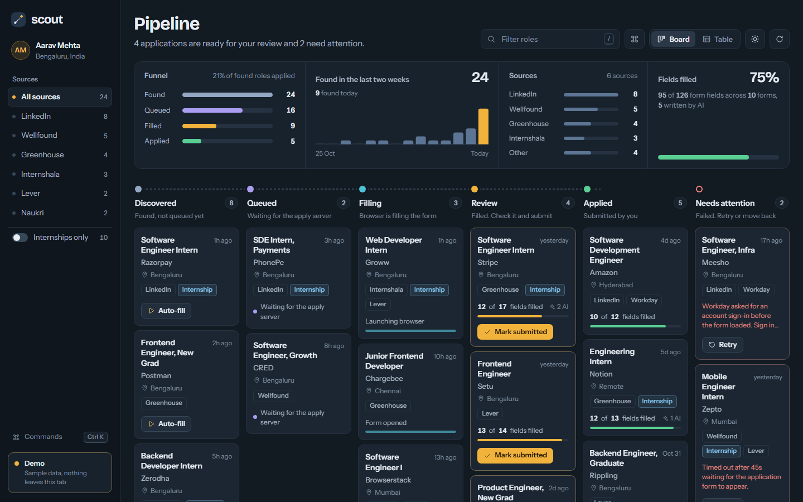
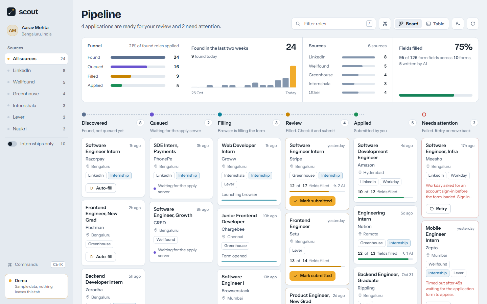
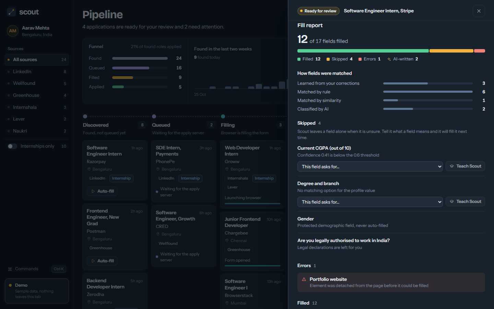
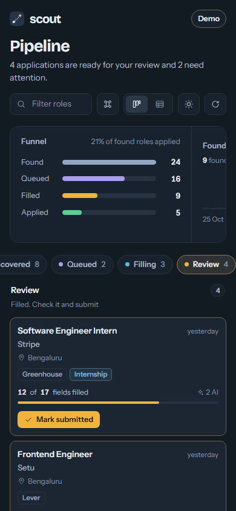

# Scout dashboard

Next.js dashboard for Scout. It shows every discovered role on a pipeline board (Discovered → Queued → Filling → Review → Applied, plus Needs attention), queues auto-fill, and shows what the apply server filled so you can review, submit and teach it fields it skipped.



| Light theme | Role details and fill report | Phone |
| --- | --- | --- |
|  |  |  |

## Setup

Create `.env.local` in this folder:

```
NEXT_PUBLIC_SUPABASE_URL=https://your-project.supabase.co
NEXT_PUBLIC_SUPABASE_ANON_KEY=your_anon_key
NEXT_PUBLIC_LOCAL_API=http://localhost:3001
```

Use the **anon** key only, never the service-role key: everything prefixed `NEXT_PUBLIC_` is shipped to the browser. Without the Supabase variables the dashboard shows a setup panel instead of failing.

```bash
npm install
npm run dev      # http://localhost:3000
npm run build    # production build + type check
```

| Variable | Purpose |
| --- | --- |
| `NEXT_PUBLIC_SUPABASE_URL`, `NEXT_PUBLIC_SUPABASE_ANON_KEY` | Read `listings` / `applications`, change application status, live updates |
| `NEXT_PUBLIC_LOCAL_API` | Apply server (default `http://localhost:3001`): `/health`, `/profile`, `/meanings`, `POST /corrections` |
| `NEXT_PUBLIC_DEMO` | `true` runs on built-in sample data |

## Demo mode

Open `http://localhost:3000/?demo=1` (or set `NEXT_PUBLIC_DEMO=true`). The dashboard uses 24 sample roles across every stage, makes no network calls, and actions change local state only: Auto-fill walks a role through Queued and Filling to Review.

## Screenshots

With the dashboard running, from the repo root:

```bash
node scripts/screenshot-dashboard.js http://localhost:3000
```

This writes the four images in `docs/screenshots/`.

## Keyboard

| Keys | Action |
| --- | --- |
| `Ctrl K` / `Cmd K` | Command menu: search roles, switch theme or layout, filter by source or stage |
| `/` | Jump to the filter box |
| `Esc` | Close the details drawer or command menu |

## Code layout

- `src/components/`: UI (board, cards, table, stats, drawer, fill report, command menu)
- `src/lib/*.js`: pure logic with JSDoc types, tested from the repo root with `npm test` (`tests/dashboard.*.test.js`)
- `src/lib/useScout.ts`: data loading, realtime updates, status changes and corrections, live or demo
